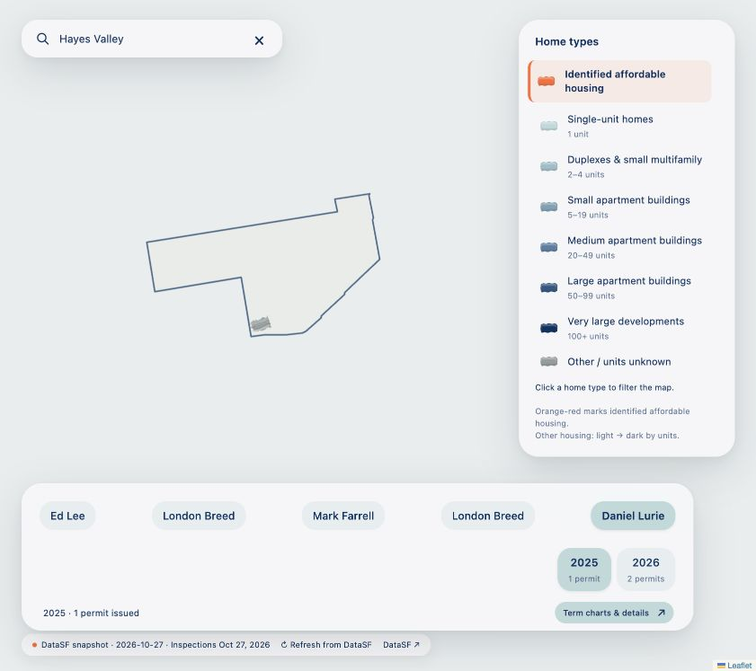

# Neighborhood focus and legend filters

Direct browser capture of this version, with Hayes Valley searched and the search input focused. Includes neighborhood outlining and outside muting, clickable home-type filters, fixed annual navigation, and refreshed overlay styling. The basemap tiles were unavailable in the browser during capture.

Resolve this commit with `git log --diff-filter=A -- screenshots/commits/06-neighborhood-focus-and-legend-filters/README.md`.
